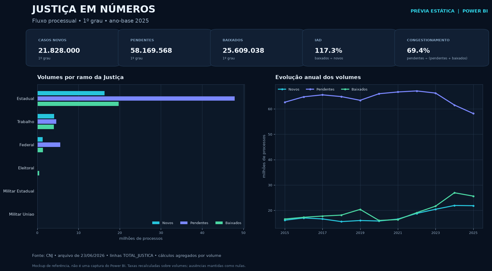

# Justiça em Números — indicadores do Poder Judiciário

**Análise exploratória em SQL dos indicadores publicados pelo Conselho Nacional de Justiça (CNJ), com acesso pela Base dos Dados e execução no Google BigQuery.**

> **Status:** o esquema BigQuery está documentado; o pacote Power BI usa o arquivo oficial do CNJ de junho de 2026 e passou por testes reproduzíveis de chave, reconciliação e fórmulas. A validação da tabela corrente no BigQuery ainda está pendente, e o arquivo interativo `.pbix` precisa ser salvo no Power BI Desktop.

## Pergunta de negócio

Como os indicadores do Justiça em Números variam entre tribunais ao longo do tempo, e quais cuidados são necessários para comparar essas métricas corretamente?

A análise foi planejada para responder:

1. Como um indicador selecionado evolui por tribunal em anos consecutivos?
2. Quais tribunais têm maiores ou menores valores do mesmo indicador e ano?
3. Onde há lacunas temporais, valores não numéricos ou possíveis conflitos de granularidade?
4. A comparação permanece válida após consultar unidade, fórmula, recorte e polaridade oficiais?

## Fonte e escopo

- **Base:** [Justiça em Números (DataJud) — Base dos Dados](https://basedosdados.org/dataset/60de97a5-aae7-4cda-871f-b314b497d768).
- **Tabela de trabalho:** `basedosdados.br_cnj_datajud.tribunal_ano`.
- **Fonte institucional:** [Conselho Nacional de Justiça](https://www.cnj.jus.br/pesquisas-judiciarias/justica-em-numeros/).
- **Cobertura descrita no catálogo:** Brasil, 2009–2025.
- **Granularidade oficial:** uma linha por `ano + sigla_tribunal + ramo_justica + sigla_indicador`. A Base dos Dados declara essa combinação como única; o script de inspeção permite testar a afirmação contra os dados publicados.
- **Recortes por grau/fase:** aparecem codificados no sufixo de `sigla_indicador`, não como colunas independentes nesta tabela.

> **Importante:** apesar do identificador técnico `br_cnj_datajud`, a tabela `tribunal_ano` contém indicadores agregados por tribunal e ano; ela não representa registros de processos judiciais individuais.

## O que este projeto entrega

- Consultas BigQuery Standard SQL para descoberta do esquema, perfil das siglas e análise exploratória da série.
- [Dicionário de dados](docs/dicionario-de-dados.md), com definições conceituais, unidades/polaridades a mapear e validações necessárias.
- [Catálogo dos 1.305 indicadores](docs/catalogo-indicadores.md), com o [CSV completo de códigos e descrições](docs/indicadores_disponiveis_2026-06.csv) e orientações de tratamento.
- [Roteiro de apresentação do dashboard no Looker Studio](docs/roteiro-apresentacao-dashboard-looker-studio.md), com fala sugerida, sequência das visualizações e campos a preencher após validar os resultados.
- [Pacote para dashboard Power BI](power-bi/README.md), com CSV CNJ tratado, medidas DAX, consulta Power Query, testes e uma prévia estática do layout.
- [Guia das consultas](sql/README.md), com entradas, etapas, campos entregues e limites de interpretação.

## Estrutura

```text
justica-em-numeros-cnj/
├── README.md
├── docs/
│   ├── dicionario-de-dados.md
│   ├── catalogo-indicadores.md
│   ├── roteiro-apresentacao-dashboard-looker-studio.md
│   └── indicadores_disponiveis_2026-06.csv
├── power-bi/
│   ├── README.md
│   ├── dados_fluxo_cnj_powerbi.csv
│   ├── medidas_dax.dax
│   ├── consulta_power_query.m
│   ├── preparar_base_powerbi.py
│   ├── validar_base_powerbi.py
│   ├── gerar_previa.py
│   └── dashboard_preview.png
└── sql/
    ├── README.md
    ├── 00_inspecao_esquema.sql
    ├── 01_perfil_indicadores.sql
    ├── 02_evolucao_ranking.sql
    └── 03_catalogo_indicadores.sql
```

## Como reproduzir

As consultas podem ser executadas diretamente no BigQuery Studio; o Apache Hop não é necessário para esta etapa exploratória.

1. Abra o BigQuery Studio e selecione seu próprio projeto Google Cloud para executar as consultas (ou use o BigQuery Sandbox, se disponível).
2. Consulte a tabela pública pelo nome completo `basedosdados.br_cnj_datajud.tribunal_ano`; não é preciso copiar os dados para seu projeto.
3. Rode [`00_inspecao_esquema.sql`](sql/00_inspecao_esquema.sql) para conferir o esquema e testar chaves repetidas/nulas. O esperado é zero chaves repetidas, mas esse resultado ainda precisa ser confirmado na tabela corrente.
4. Rode [`01_perfil_indicadores.sql`](sql/01_perfil_indicadores.sql) para identificar siglas, cobertura e ramos da Justiça.
5. Consulte os dicionários auxiliares do dataset e do CNJ para confirmar descrição, fórmula, unidade, escopo e polaridade do indicador escolhido.
6. Execute [`02_evolucao_ranking.sql`](sql/02_evolucao_ranking.sql) após configurar um indicador validado; a análise mantém o ramo da Justiça na chave, na série temporal e no ranking.
7. Use [`03_catalogo_indicadores.sql`](sql/03_catalogo_indicadores.sql) para consultar códigos, descrições e cobertura observada.
8. Registre a data de extração e documente resultados validados, limitações e unidades antes de publicar.

Detalhes de cada script: [guia das consultas SQL](sql/README.md).

## Decisões de análise

- Cada comparação deve ocorrer dentro do **mesmo indicador**, período e recorte comparável.
- A variação percentual é calculada apenas quando existe observação no ano imediatamente anterior e o denominador não é zero.
- Valores múltiplos na chave proposta devem ser investigados; podem refletir recortes omitidos, não erros da fonte.
- O ranking é descritivo e ordena o maior valor primeiro. Não significa automaticamente melhor ou pior desempenho.
- Nulos não são tratados como zero.
- A polaridade depende do indicador. Por exemplo, o CNJ descreve o Índice de Atendimento à Demanda como “quanto maior, melhor”, enquanto algumas taxas de congestionamento têm interpretação inversa.

## Resultados

O pacote Power BI traz uma prévia estática calculada com as linhas consolidadas da publicação CNJ de junho de 2026. A versão interativa ainda precisa ser montada e conferida no Power BI Desktop; os resultados das consultas SQL no BigQuery também permanecem pendentes.

## Dashboard Power BI



Consulte o [passo a passo para importar os dados, criar medidas e montar as páginas](power-bi/README.md). A imagem é uma prévia estática do layout, não uma captura de um relatório interativo.

## Tecnologias

`SQL` · `Google BigQuery` · `Power BI` · `DAX` · `Power Query` · `Python` · `CNJ`

## Sugestão de publicação no LinkedIn

> Estou desenvolvendo uma análise de dados públicos do **Justiça em Números, do CNJ**, usando SQL no Google BigQuery e a Base dos Dados.
>
> Neste projeto, investiguei **[indicador e período]** por **[recorte comparável]**, com foco em **[pergunta de negócio]**. Antes da análise, validei o esquema, as siglas, a unidade e a granularidade dos dados.
>
> **Resultado observado:** [inclua aqui um achado que tenha sido executado e validado].
>
> Código e documentação: [link para este projeto no GitHub]
>
> #SQL #BigQuery #DadosAbertos #CNJ #Analytics

## Referências

- [Dataset Justiça em Números (DataJud) — Base dos Dados](https://basedosdados.org/dataset/60de97a5-aae7-4cda-871f-b314b497d768)
- [Schema YAML oficial — Base dos Dados](https://github.com/basedosdados/pipelines/blob/main/models/br_cnj_datajud/schema.yml)
- [SQL oficial de transformação — Base dos Dados](https://github.com/basedosdados/pipelines/blob/main/models/br_cnj_datajud/br_cnj_datajud__tribunal_ano.sql)
- [Glossário dos Indicadores de Desempenho — CNJ, fevereiro de 2026](https://www.cnj.jus.br/wp-content/uploads/2026/02/glossario-indicadores-desempenho-13-02-2026.pdf)
- [Base de dados do Justiça em Números — CNJ](https://www.cnj.jus.br/pesquisas-judiciarias/justica-em-numeros/base-de-dados/)
